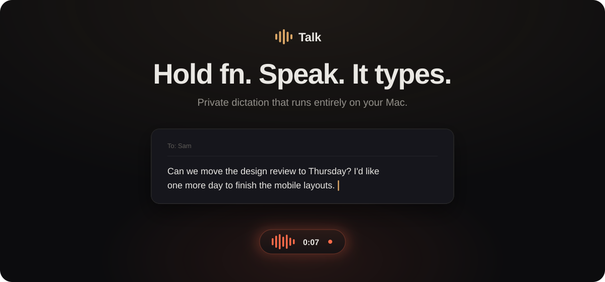
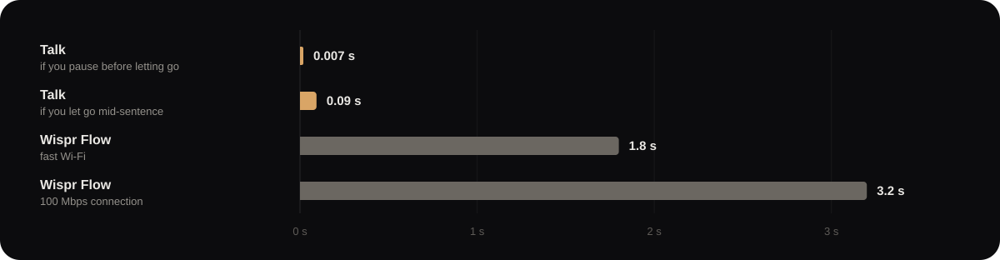
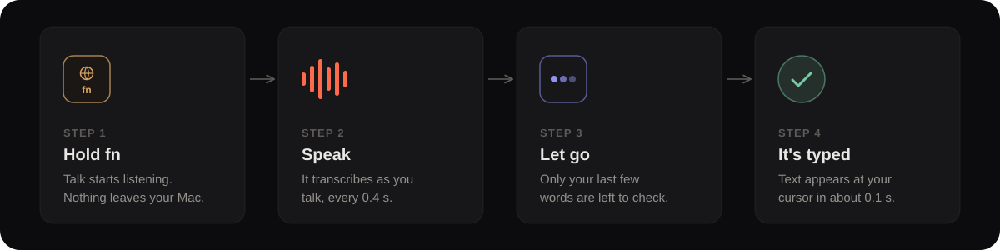

<p align="center">
  
</p>

<p align="center">
  The free, private Wispr Flow alternative for Mac.
</p>

<p align="center">
  <a href="#install">Install</a> &nbsp;·&nbsp;
  <a href="#talk-vs-wispr-flow">Talk vs Wispr Flow</a> &nbsp;·&nbsp;
  <a href="#how-it-works">How it works</a>
</p>

<br>


## Talk vs Wispr Flow

Wispr Flow sends your voice to its servers. Talk keeps it on your Mac, so it is
faster, works offline, and costs nothing.



|  | Talk | Wispr Flow |
| --- | --- | --- |
| Price | Free | $15 a month, $12 billed yearly |
| Free plan | Unlimited | 2,000 words a week |
| Your voice | Stays on your Mac | Sent to Wispr's servers |
| Works offline | Yes | No |
| Text appears | About 0.1 s after you let go | 1.8 to 3.2 s |
| Memory | 1.3 GB, the model runs on your Mac | About 170 MB, the model runs in the cloud |

<sub>Talk measured on an M4 Pro MacBook Pro; accuracy on LibriSpeech. Wispr Flow
from its [pricing](https://wisprflow.ai/pricing) and [data controls](https://wisprflow.ai/data-controls)
pages, latency tests by [LumeVoice](https://lumevoice.com/blog/does-wispr-flow-work-offline-2026/)
and [MetaWhisp](https://metawhisp.pages.dev/blog/metawhisp-vs-wispr-flow/), and a memory
reading by [Technovice](https://www.technovice.net/post/wispr-flow-review).</sub>

## How it works

Talk listens only while you hold the key, and does all its work on your Mac.



## Install

Talk needs a Mac with Apple silicon (M1 or newer) and macOS 15 or later. Open
Terminal and paste:

```sh
git clone https://github.com/0xWerz/talk.git
cd talk && ./install.sh
```

The first install takes a few minutes, mostly to download the speech model
(2.5 GB). When Talk opens, turn on the three permissions it asks for. To update
later, run `git pull && ./install.sh` in the same folder.

## Using it

| Do this | To |
| --- | --- |
| Hold <kbd>fn</kbd>, speak, let go | Type what you said |
| Double-tap <kbd>fn</kbd> | Speak hands-free, tap again to finish |
| Press <kbd>esc</kbd> while speaking | Cancel |

Talk removes filler words, fixes names it tends to mishear, and keeps a history
of recent dictations. Click the menu-bar icon for settings.

## Uninstall

Run `./uninstall.sh` from the Talk folder.

<br>

<details>
<summary><b>For developers</b></summary>

<br>

Talk is two parts that talk over a local socket. `app/` is the Swift menu-bar
app: the key, the microphone, the floating pill and pasting. `sidecar/` is the
speech engine: NVIDIA Parakeet TDT 0.6B v2 on Apple's MLX, plus the cleanup rules.

It stays fast in three ways. It transcribes while you talk, re-reading the
recording every 0.4 s, so on release only the last few seconds are checked
again, or nothing if you paused. Its decoder runs on the CPU instead of making
hundreds of round trips to the GPU. And the model stays locked in memory, so the
first dictation after a break is as quick as any other. Accuracy matches
transcribing the whole clip at once.

```sh
make run      # build and launch from this checkout
make test     # engine tests and a Swift build
```

Settings are in `~/Library/Application Support/Talk/config.json` and the engine
log is next to it.

</details>
